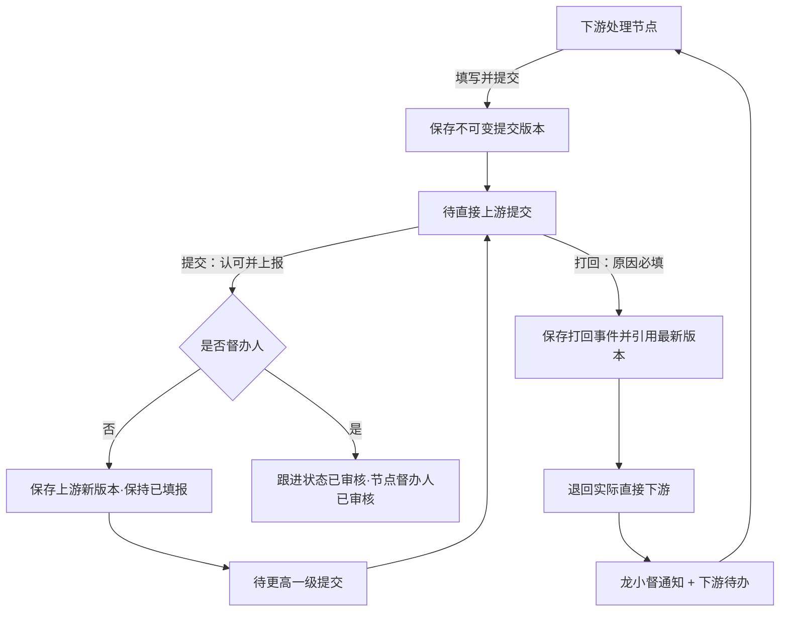
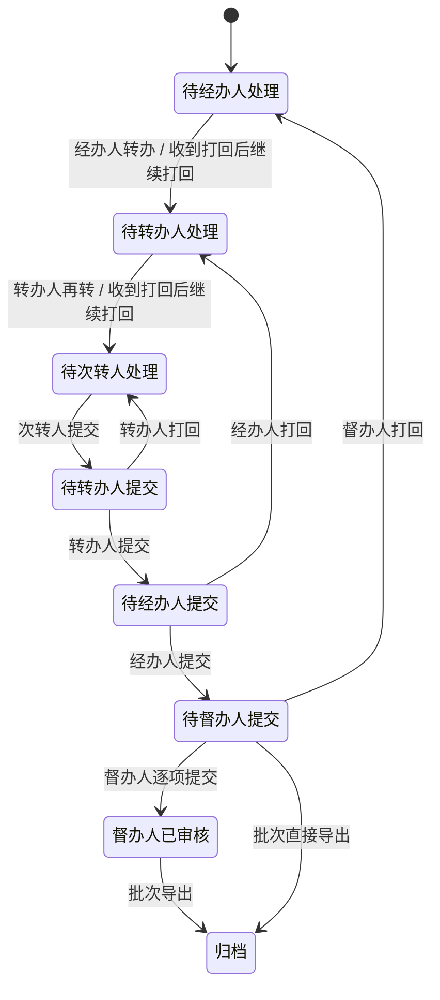
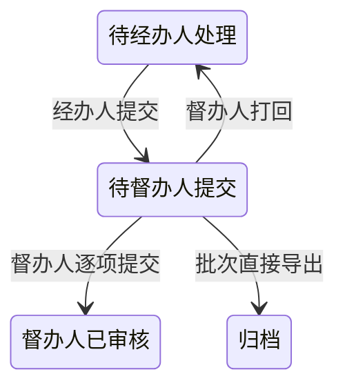
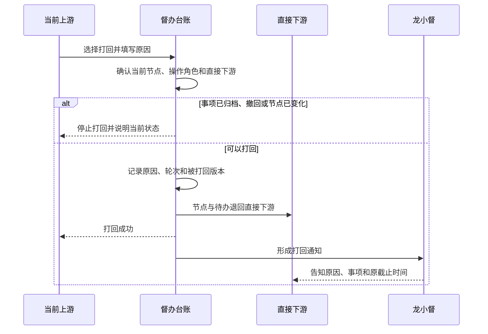
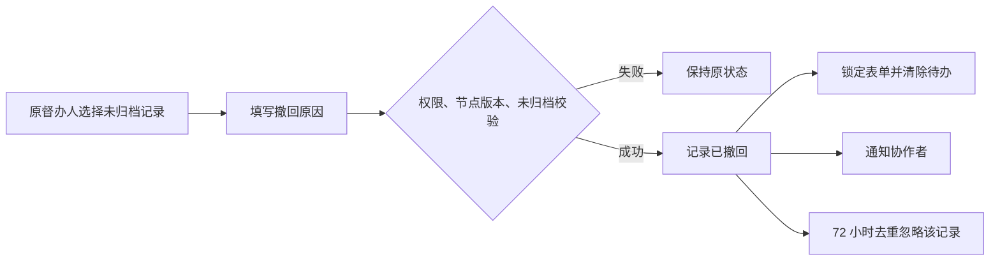
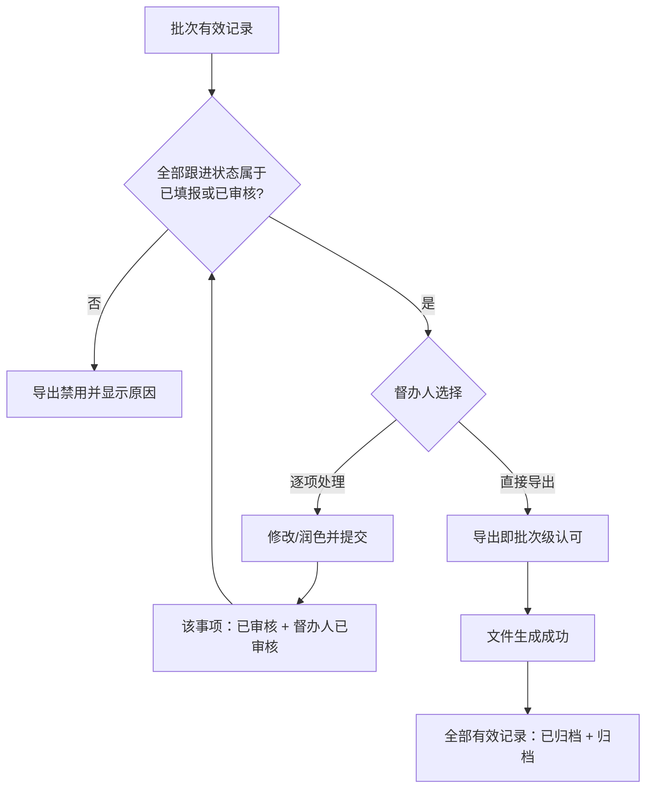

# 流程图：龙小督台账 V2

## 提交与打回主流程

## 完整三级链

## 无转办链

## 打回业务时序

## 撤回流程

## 督办人终审与导出

## 批次多选与导出

- 进入台账默认全选全部未归档批次；已归档批次默认不选中但可手动回看。
- 所选批次的全部事项形成统一事项合集；按逾期未填报、跟进中、已填报、已审核、已归档、已撤回排序，同一状态再按截止时间、批次序号、事项编号排序。
- 当前批次选择范围同时决定导出范围；任一选中批次失效或已归档，则阻止整个合并导出。
- 导出弹窗只确认所选批次数、总事项数、已撤回数和实际导出数，不再选择批次。
- 导出成功后归档所选批次的非撤回记录，已归档批次取消选择，并重新全选剩余未归档批次。
